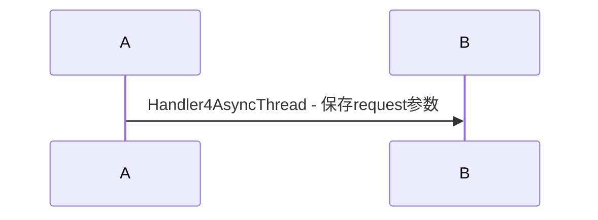
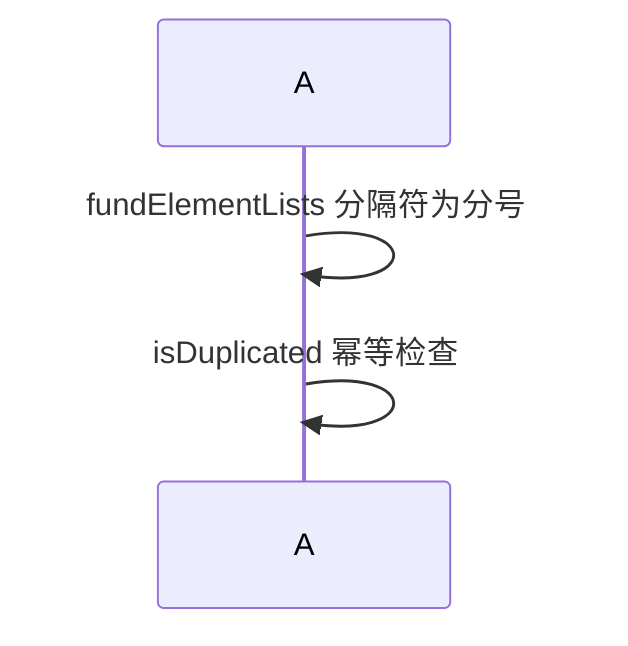
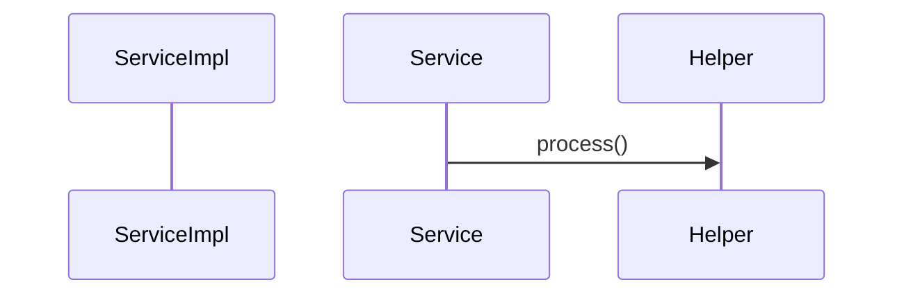
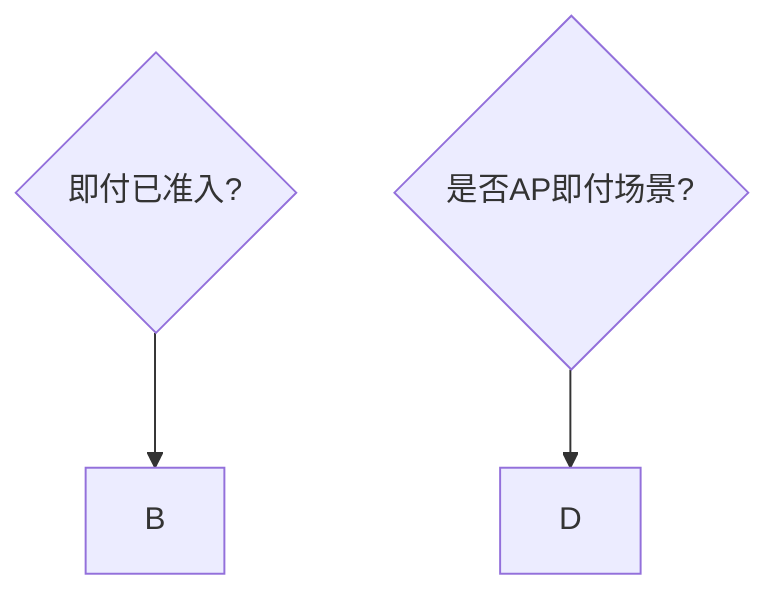
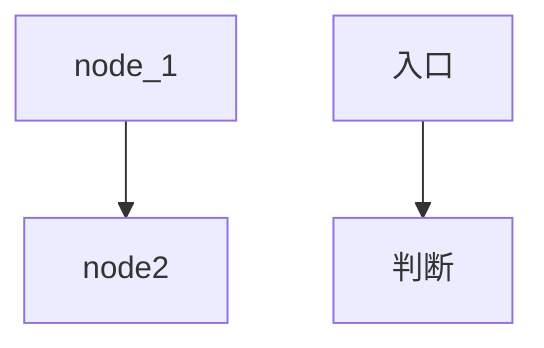
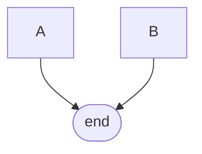
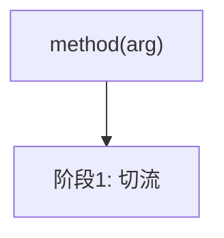
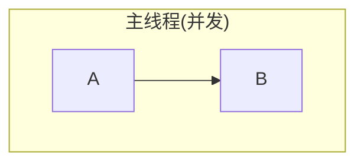

# Mermaid 图表生成规则（完整版）

> 生成任何 Mermaid 图后，必须按本文档自检。一个小语法错误 = 整张图渲染失败。

---

## 一、总则

1. **生成后必须验证** — 写完必须过自检清单（见第五章），不确定就粘贴到 mermaid.live 预览
2. **优先使用保守语法** — 不确定的写法宁可绕行，不要尝试花哨语法
3. **修改 Mermaid 时禁止全局 sed** — 对包含 Mermaid 的 Markdown 文件做全局文本替换极易破坏箭头语法（`-->` / `->>` / `-->>` 等）
4. **节点标签一律用 `""` 双引号包** — 宁可冗余也不出错

### 图表类型选择

| 场景 | 推荐类型 | 判定口诀 |
|------|---------|---------|
| 跨类/跨服务调用，强调"谁调谁"、异步/并行 | `sequenceDiagram` | 强调时序+协作方 |
| 纯本类内 if-else/switch 决策树 | `flowchart TD` | 强调逻辑分支 |
| 数据流动（A→B→C 处理→D 存储） | `flowchart LR` + `subgraph` | 强调数据流向 |
| 多条并行链路对比 | `flowchart` + 多个 `subgraph` 并列 | 强调并行对比 |
| 状态流转 | `stateDiagram-v2` | 状态机语义 |

---

## 二、sequenceDiagram 规则

### 红线 1：消息文本中禁止半角冒号 `:`

Mermaid 语法 `A->>B: Message` 中，**第一个冒号后的所有内容都是消息文本**。消息文本内再出现冒号会导致解析错误。

❌ 错误：
```
sequenceDiagram
    A->>B: Handler4AsyncThread: 保存request参数
```

✅ 正确（用 ` - ` 或全角 `：` 替代）：


### 红线 2：消息文本和 Note 中禁止以下特殊字符

| 字符 | 冲突原因 | 替换方案 |
|------|---------|---------|
| `;` 半角分号 | 被当作语句结束符 | 用 `，` 逗号或文字描述替代 |
| `；` 全角分号 | 同上 | 同上 |
| `→` Unicode 箭头 | 与 Mermaid 箭头混淆 | 用"调用"、"返回"替代 |
| `（）` 全角括号 | 破坏消息标签解析 | 去掉或用 `【】` 替代 |
| `?` 问号 | 可能触发条件解析 | 用"是否"替代 |
| `/` 斜杠 | 自引用消息中歧义 | 用"和"、顿号替代 |
| `—` em-dash | 编码问题 | 用 `-` 或 `--` 替代 |

❌ 错误：
```
sequenceDiagram
    A->>A: fundElementLists（分隔符 ;）
    A->>A: isDuplicated(context)? — 幂等检查
```

✅ 正确：


### 红线 3：Participant 名禁止含点号、包名、括号

参与方名只允许：英文字母、数字、下划线。

❌ 错误：
```
sequenceDiagram
    participant A as Service(Impl)
    com.example.Service ->> com.example.Helper: process()
```

✅ 正确：


### 红线 4：Participant 别名不支持 `<br/>`

`<br/>` 只能用在 flowchart 节点标签里，不能用在 sequenceDiagram 的 participant 名里。

❌ 错误：
```
participant Adapter as PollingPayPreConsult<br/>AsyncPrepareAdapter
```

✅ 正确：
```
participant Adapter as "PollingPayPreConsult Adapter"
```

### 增强规则：≥3 个时序阶段时必须做

1. **用 `Note over` 分阶段**：每个阶段开头加总结性 Note
2. **用 `rect rgb(...)` 颜色块**圈关键阶段（配色固定语义）：
    - 黄色 `rect rgb(255, 240, 200)` = 判断/切流/校验
    - 蓝色 `rect rgb(200, 230, 255)` = 异步发起/任务提交
    - 绿色 `rect rgb(200, 255, 200)` = 成功复用/缓存命中
    - 粉色 `rect rgb(255, 220, 220)` = 兜底降级/异常处理
3. **关键分支用 `alt / else`** 显式表达

---

## 三、flowchart 规则

### 红线 5：节点标签中禁止 HTML 标签

flowchart 的节点标签不支持 `<br>` / `<b>` 等 HTML 标签，会导致 Parse error。

❌ 错误：
```
flowchart TD
    A["第一行<br>第二行"]
```

✅ 正确（用空格或拆节点）：


> 注意：`<br/>` 在部分渲染器中可用，但 `<br>`（无斜杠）一定报错。为安全起见统一避免使用。

### 红线 6：菱形节点 `{}` 内禁止括号 `()`

菱形是 Mermaid 的判断节点，内部的 `()` 会干扰解析器对节点形状的识别。

❌ 错误：
```
flowchart TD
    A{"isNfcFlashPayAccessSuccess() ?"} --> B
    C{"是否AP场景(即付)?"} --> D
```

✅ 正确（去掉括号，只保留核心判断问题）：


### 红线 7：节点 ID 必须 ASCII，不能含 `-` `.` 空格

- 节点 ID 只允许英文字母、数字、下划线
- 中文只能放标签 `["..."]` 里

❌ 错误：
```
flowchart TD
    node-1 --> node.2
    入口 --> 判断
```

✅ 正确：


### 红线 8：节点形状只能定义一次

重复引用同一节点时，第二次及之后必须只用纯 ID。

❌ 错误：
```
flowchart TD
    A --> E([end])
    B --> E([end])
```

✅ 正确：


### 红线 9：节点标签含特殊字符必须用 `""` 包

含 `()` `:` `,` `{}` `<` `>` `/` 等字符的标签必须用双引号。

❌ 错误：
```
flowchart TD
    A[method(arg)] --> B[阶段1: 切流]
```

✅ 正确：


### 红线 10：subgraph 名含特殊字符必须用引号 + ASCII ID



### 红线 11：中文全角标点必须先转半角

生成 Mermaid 前，必须把 `（）；：` 等全角标点转为 ASCII 半角，然后按上述规则处理。

---

## 四、修改 Mermaid 文件的安全规则

### 禁止全局 sed 替换

Mermaid 箭头语法依赖 `-` 和 `>` 的精确组合（`-->` / `->>` / `-->>` / `-.->` 等），全局替换会破坏这些组合。

**修改 Mermaid 内容时**：
1. 仅定位到 Mermaid 代码块内部进行替换（不要全局 `sed`）
2. 优先使用 Edit 工具精确修改（指定 `old_string`）
3. 修改后检查箭头是否完整（`grep -n '→>' report.md` / `grep -n '-→' report.md`）

---

## 五、自检清单（生成 Mermaid 后必跑）

### sequenceDiagram 自检

- [ ] 每条消息文本中**没有半角冒号 `:`**
- [ ] 没有分号 `;` 或 `；`
- [ ] 没有 Unicode 箭头 `→`、问号 `?`、斜杠 `/`、全角括号 `（）`
- [ ] Participant 名只有英文/数字/下划线，无点号无括号
- [ ] Participant 别名中没有 `<br/>`
- [ ] Note 文本无特殊字符
- [ ] 箭头类型正确：`->>` 实线，`-->>` 虚线

### flowchart 自检

- [ ] 每个节点 ID 只有一次形状定义？重复引用用纯 ID？
- [ ] 节点 ID 都是 ASCII（无 `-` `.` 空格中文）？
- [ ] 节点标签用 `""` 包了？
- [ ] 节点标签中**没有 HTML 标签** `<br>` 等？
- [ ] 菱形 `{}` 中**没有括号** `()`？
- [ ] 中文全角标点已转半角？
- [ ] subgraph 用了 ASCII ID + 引号显示名？

**只要有一条不通过，先修再贴。不要把没自检的 Mermaid 输出给用户。**

---

## 六、常见错误速查表

| 错误现象 | 常见原因 | 快速修复 |
|---------|---------|---------|
| Parse error: Expecting 'SOLID_OPEN_ARROW'... got 'NEWLINE' | 消息文本含分号 `;` 或冒号 `:` | 替换为逗号或 `-` |
| Parse error on participant line | 参与方名含点号或括号 | 只用短类名 |
| 流程图菱形节点出错 | 菱形 `{}` 中有括号 `()` | 移除括号 |
| 流程图方框节点出错 | 标签内有 `<br>` 或未引号 | 去 HTML + 加 `""` |
| Each node can have only one shape | 同一节点 ID 多次定义形状 | 第二次起只用纯 ID |
| 全场箭头异常 | 全局 sed 破坏了箭头组合 | 精确修改，不全局替换 |